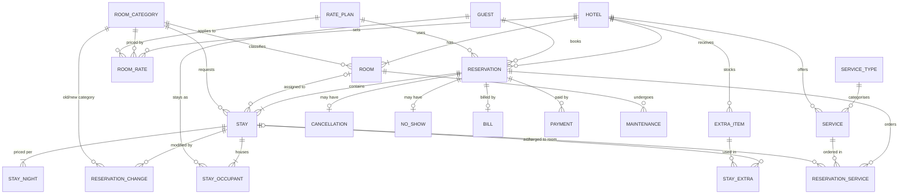

# GSHG ERD

Source of truth for the design (replaces `legacy/Advance database.excalidraw`).
Notation: crow's foot (Information Engineering), as in lecture W1. Export to PNG/SVG for the report with
`npx -y @mermaid-js/mermaid-cli -i erd.md -o erd.svg` or paste a block into https://mermaid.live.

Changes from the excalidraw version are marked `NEW` / `CHANGED` and explained in [design-review.md](design-review.md).

## 1. Conceptual ERD (entities, relationships, cardinality, optionality)

## 2. Logical design (attributes, PK/FK, SQL Server types)

```mermaid
erDiagram
    HOTEL {
        int hotel_id PK
        nvarchar name
        nvarchar country
        nvarchar city
        char currency_code
        time checkin_deadline "after this = no-show"
    }
    ROOM_CATEGORY {
        int category_id PK
        nvarchar category_name "Standard, Deluxe, Family, Suite"
    }
    ROOM {
        int room_id PK
        int hotel_id FK
        int category_id FK
        nvarchar room_no "UNIQUE with hotel_id"
        tinyint max_occupancy
        bit is_accessible
    }
    RATE_PLAN {
        int rate_plan_id PK
        nvarchar plan_name
        decimal noshow_charge_pct
    }
    ROOM_RATE {
        int rate_id PK
        int hotel_id FK
        int category_id FK
        int rate_plan_id FK
        date start_date
        date end_date
        decimal nightly_rate
        decimal child_rate_pct
    }
    GUEST {
        int guest_id PK
        nvarchar full_name
        date dob
        nvarchar email "nullable, occupants may be children"
        nvarchar phone "nullable"
    }
    RESERVATION {
        int reservation_id PK
        int hotel_id FK
        int booker_id FK "GUEST"
        int rate_plan_id FK
        nvarchar status "Pending, Confirmed, Checked In, Checked Out, Cancelled"
        datetime2 created_at
    }
    STAY {
        int stay_id PK
        int reservation_id FK
        int room_id FK "nullable until assigned"
        int category_id FK "requested category"
        datetime2 scheduled_checkin
        datetime2 scheduled_checkout
        datetime2 actual_checkin
        datetime2 actual_checkout
        bit accessible_requested
    }
    STAY_NIGHT {
        int stay_id PK, FK
        date night_date PK
        decimal rate_charged "rate at time of booking"
    }
    STAY_OCCUPANT {
        int stay_id PK, FK
        int guest_id PK, FK
    }
    EXTRA_ITEM {
        int item_id PK
        int hotel_id FK
        nvarchar item_name "Extra bed, Baby cot"
        decimal daily_charge
        int total_stock
    }
    STAY_EXTRA {
        int stay_extra_id PK
        int stay_id FK
        int item_id FK
        int quantity
        decimal charge_amount
    }
    SERVICE_TYPE {
        int service_type_id PK "NEW"
        nvarchar type_name "Airport transfer, Breakfast, Parking, Spa"
    }
    SERVICE {
        int service_id PK
        int hotel_id FK
        int service_type_id FK "NEW"
        nvarchar service_name
        nvarchar charge_basis "Per person, Per room, Per reservation"
        decimal unit_price
    }
    RESERVATION_SERVICE {
        int res_service_id PK
        int reservation_id FK
        int service_id FK
        int stay_id FK "NEW nullable, for per-room/per-person services"
        date service_date "NEW"
        int quantity
        decimal charge_amount
    }
    RESERVATION_CHANGE {
        int change_id PK
        int stay_id FK "CHANGED from reservation_id"
        int old_category_id FK
        int new_category_id FK
        datetime2 old_checkin
        datetime2 old_checkout
        datetime2 new_checkin
        datetime2 new_checkout
        decimal price_difference
        datetime2 changed_at
    }
    CANCELLATION {
        int cancellation_id PK
        int reservation_id FK "UNIQUE"
        datetime2 cancelled_at
        decimal charge_amount
    }
    NO_SHOW {
        int noshow_id PK
        int reservation_id FK "UNIQUE"
        datetime2 recorded_at
        decimal charge_amount
    }
    BILL {
        int bill_id PK
        int reservation_id FK "UNIQUE"
        decimal room_charge
        decimal service_charge
        decimal discount
        decimal extra_charge
        datetime2 issued_at
    }
    PAYMENT {
        int payment_id PK
        int reservation_id FK
        decimal amount
        nvarchar method
        nvarchar pay_type "Payment or Refund"
        datetime2 paid_at
    }
    MAINTENANCE {
        int maintenance_id PK
        int room_id FK
        date start_date
        date expected_end_date "CHANGED from end_date"
        date actual_end_date "NEW nullable, null = still under maintenance"
        nvarchar reason
    }

    HOTEL ||--|{ ROOM : has
    ROOM_CATEGORY ||--o{ ROOM : classifies
    HOTEL ||--o{ ROOM_RATE : sets
    ROOM_CATEGORY ||--o{ ROOM_RATE : "priced by"
    RATE_PLAN ||--o{ ROOM_RATE : "applies to"
    HOTEL ||--o{ RESERVATION : receives
    GUEST ||--o{ RESERVATION : books
    RATE_PLAN ||--o{ RESERVATION : uses
    RESERVATION ||--|{ STAY : contains
    ROOM |o--o{ STAY : "assigned to"
    ROOM_CATEGORY ||--o{ STAY : requests
    STAY ||--|{ STAY_NIGHT : "priced per"
    STAY ||--|{ STAY_OCCUPANT : houses
    GUEST ||--o{ STAY_OCCUPANT : "stays as"
    HOTEL ||--o{ EXTRA_ITEM : stocks
    STAY ||--o{ STAY_EXTRA : adds
    EXTRA_ITEM ||--o{ STAY_EXTRA : "used in"
    SERVICE_TYPE ||--o{ SERVICE : categorises
    HOTEL ||--o{ SERVICE : offers
    RESERVATION ||--o{ RESERVATION_SERVICE : orders
    SERVICE ||--o{ RESERVATION_SERVICE : "ordered in"
    STAY |o--o{ RESERVATION_SERVICE : "charged to room"
    STAY ||--o{ RESERVATION_CHANGE : "modified by"
    ROOM_CATEGORY ||--o{ RESERVATION_CHANGE : "old/new category"
    RESERVATION ||--o| CANCELLATION : "may have"
    RESERVATION ||--o| NO_SHOW : "may have"
    RESERVATION ||--o| BILL : "billed by"
    RESERVATION ||--o{ PAYMENT : "paid by"
    ROOM ||--o{ MAINTENANCE : undergoes
```

